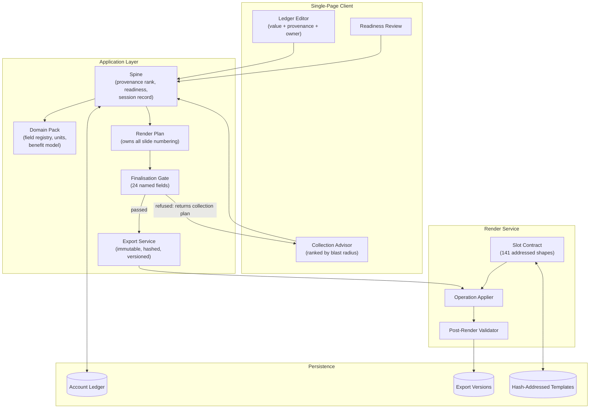

# Provenance-Gated Document Generation — Case Study

## Overview

Designed and built a platform that generates customer-facing executive briefing decks from an evidence ledger rather than from a human author. Every number the deck prints is a ledger record carrying a value, a provenance, an owner, and the list of slides it feeds. The deck is a render of that ledger. Nothing is typed into a slide, so nothing can reach a customer without declaring where it came from.

The system covers the full lifecycle: collecting field values with their sources, advising the engineer which gaps to close first by blast radius, deriving a benefit model whose grade inherits the weakest provenance among its inputs, refusing finalisation when named evidence is absent, and rendering an immutable, hashed, versioned deliverable against a cryptographically addressed template.

At build-out the platform renders a 39-slide briefing deck through a 141-entry slot contract, enforces a finalisation gate over 24 named evidence fields, and ships as a React single-page client, a Node API and a Python render service on serverless container infrastructure.

---

## The Short Version

**A deck is not a document. It is a render of an evidence ledger.**

Every number a customer-facing deck prints is a ledger record carrying a value, a
provenance, an owner, and the list of slides it feeds. Nothing is typed into a slide, so
nothing reaches a customer without declaring where it came from. What follows from that:

| The decision | Instead of |
|---|---|
| A derived number **inherits the worst provenance among its inputs**, mechanically | Letting a roll-up launder one modelled estimate in among nine confirmed figures |
| Finalisation is refused on a **named set of absent fields**, and the refusal *is* the worklist | A completeness percentage nobody can act on |
| Absence is a **first-class state** (`missing`), never undefined | Four unrelated-looking bugs with one cause |
| Derived values are **never stored** — recomputed every render | A stored total that can disagree with its own inputs |
| Template drift is a **refusal, not a warning** | 372 operations applied, 1 silently lost, validation clean |
| A pack that checks nothing is **refused as vacuous** | A gate that passes because it was handed no work |

The governing test, applied throughout: **refuse where the failure mode is silent; warn
where it is loud.** Not how bad the outcome is — whether anyone would notice.

If you read one more section, read [Design Decisions](#design-decisions), then
[Stated Limitations](#stated-limitations).

---

## The Problem

Executive briefing decks for enterprise engagements are assembled by hand, slide by slide, from whatever numbers are to hand. Some come from the customer. Some come from public filings. Some are modelled by the account team. By the time the deck reaches the customer, nobody can reliably say which is which.

That matters more than it sounds. A modelled number presented as the customer's own figure is the kind of mistake that gets discovered in the room, by the person who owns the real number. The deck does not look wrong. It looks finished.

The challenge was threefold:

1. **Provenance is lost at authoring time** — Once a figure is typed into a slide, the information needed to review it is gone. A review step cannot recover it, because the reviewer is reading an output that no longer carries its own sources.
2. **Derived numbers launder their inputs** — A total built from nine confirmed figures and one modelled estimate reads as confirmed. Without a mechanical rule, every roll-up quietly upgrades the confidence of its weakest input.
3. **Silent failure beats loud failure to production** — Template drift, missing stamps and mis-numbered slides all produce a file that opens correctly and is wrong. Nothing in a conventional document pipeline notices.

Existing approaches — a shared template, a review checklist, a completeness percentage — all failed the same way: they asked a human to notice something the system had already discarded.

---

## Architecture

### High-Level Design

> Full architecture diagrams — provenance resolution, the render lifecycle, the gate decision tree, export versioning and the spine/pack boundary — are in [`/architecture/diagrams.md`](architecture/diagrams.md).

### The Provenance Model

Four sources, ordered worst-last. Every value carries exactly one.

| Source | Meaning | Treatment in the deck |
|---|---|---|
| `client` | The customer supplied or confirmed this figure | Printed as fact, unstamped |
| `public` | Published filing, report or disclosure | Printed as fact, unstamped |
| `modelled` | Derived by the account team from assumptions | Printed with an illustrative stamp |
| `missing` | No record exists | Blocks the field; appears on the collection plan |

**An absent record reads as `missing`, never as undefined.** This sounds pedantic and was a real defect. While absence read as undefined, newly introduced fields became simultaneously invisible to the gap list, the collection plan, the advisor and the stamping logic — and all four failures presented as separate, unrelated bugs.

**Weakest link.** A derived number inherits the worst provenance among its inputs. A roll-up built on one modelled input is a modelled number and is stamped as one, however many confirmed figures sit beside it. Because provenance is a property of the value rather than a note beside it, this rule is mechanical rather than a judgment call.

### Spine and Packs

| Layer | Knows | Must not know |
|---|---|---|
| **Spine** | How provenance is ranked, how readiness is derived, how a session is recorded, how exports are versioned | What any individual field means |
| **Domain Pack** | What a field means, what unit it is in, what the benefit model does with it, which template it renders to | How provenance ranking or readiness is implemented |

Nothing in the spine may import a pack. Spine functions take the field registry as an argument instead. A second, deliberately minimal pack exists purely to keep that boundary honest — and it earned its place immediately by exposing a class of bug the main pack could not (see *Design Decision 2*).

### The Slot Contract

The render target is a 39-slide template. The contract addresses **141** of its text-bearing shapes and cells — 45 value slots and 96 furniture strings — out of **1,267** present in the file. Shapes are addressed by slide number and the authoring tool's auto-generated shape name; table cells by flat index. None of that addressing survives a different template, which is why the contract is bound to a template hash rather than a filename.

---

## Design Decisions

### 1. Gate on a Named Set, Not a Completeness Score

**Decision:** Finalisation is refused on a named list of absent fields, not below a percentage threshold.

**Why:** A percentage is gameable and, worse, uninformative. *"82% evidenced"* does not tell a reviewer which 18% is missing or whether it matters. The gate instead collects a named set — every field the benefit model reads, plus the avoidable shares, the realisation factor and the investment profile — and refuses on the ones that are absent, by name. A refusal returns the collection plan itself: the same ranked, owner-grouped structure the engineer already works from, so *why was this refused* and *what do I do about it* resolve to one answer rather than two screens.

**Trade-off:** The named set has to be maintained as the benefit model grows. Accepted, and guarded by the lever-input test described in *Stated Limitations*.

### 2. A Pack That Checks Nothing Is Refused as Vacuous

**Decision:** A domain pack declaring no value inputs fails the gate rather than passing it.

**Why:** Without that rule, the minimal test pack sailed through the gate — it had nothing to check, so nothing failed. A gate that passes because it was handed no work is worse than no gate at all, because it produces a finalisation record. The emptiness of the check has to be an error condition in its own right.

**Trade-off:** Adds a startup-time validation that pack authors must satisfy before anything renders. This is the intended friction.

### 3. Derived Values Are Never Stored

**Decision:** Readiness, the value case, the stamp set and the collection plan are recomputed on every render from ledger primitives.

**Why:** A stored derivation is a number that can disagree with its own inputs, and nothing in the system will say so. Recomputation costs milliseconds; a stale stored total costs credibility in front of a customer.

**Trade-off:** No historical snapshot of a derivation except where one was deliberately captured at export. Acceptable, because the export captures the input snapshot that reproduces it.

### 4. The Stamp Is a Rendered Decision, Not Template Furniture

**Decision:** Every stamp shape is written on every render — the stamp text where provenance calls for it, empty where it does not.

**Why:** Stamps were originally pre-printed on the template, on 22 of 39 slides, and nothing ever removed them. A fully evidenced account produced a deck stamped *illustrative* on slides whose every number was confirmed, and the stamp count in the interface read identically for every account, so it carried no information. A stamp that is always present is not a signal.

**Trade-off:** More write operations per render. A slide that needs a stamp and has nowhere to put one is **reported** rather than silently skipped.

### 5. Hash the Input Snapshot, Not the File Bytes

**Decision:** The export fingerprint covers the input snapshot rather than the rendered binary.

**Why:** Office formats are zip archives with embedded timestamps. Byte hashing reports a change on every render of identical content, and a change detector that always fires is not a change detector.

**Trade-off:** Two renders of the same inputs by different renderer versions hash identically. Renderer version is therefore recorded alongside the hash as separate metadata.

### 6. Supersession Is Derived, Not Flagged

**Decision:** A later ledger change never regenerates an export; it produces version *n+1*, and `superseded` is derived from the existence of a higher version.

**Why:** A flag that must be set is a flag that will be missed. Deriving the state from the version sequence makes it impossible for a superseded export to present itself as current.

**Trade-off:** Version listings must be queried rather than read from a single field. Negligible at the intended scale.

### 7. Template Mismatch Is a Refusal, Not a Warning

**Decision:** The contract records the hash of the template it was derived from, and the render refuses on a mismatch.

**Why:** Rendering against a mismatched template was tested directly. The result: **372 operations applied, 1 failed, validation clean.** One value silently lost, a file that opens correctly, and nothing anywhere saying so. A warning gets read once and then filtered. The failure mode here is silent, so the response has to be a refusal.

**Trade-off:** A legitimate template revision requires re-deriving the contract. Tooling exists for that and the derived output is reviewed before it is committed.

### 8. Numbering Lives in Exactly One Module

**Decision:** The render plan owns all slide numbering; the renderer performs no index arithmetic.

**Why:** Slide duplication combined with slide addressing was got wrong in both directions during development. Duplicating last made fourteen operations fail loudly, which was recoverable. Duplicating first without remapping wrote one slide's content onto another **silently**, which was not. Centralising the arithmetic removed the entire class.

**Trade-off:** The renderer cannot make local layout decisions. Intended.

### 9. Colour Carries Information, So It Was Validated as Information

**Decision:** The provenance palette was validated against perceptual separation criteria, and the dark theme was derived independently rather than dimmed from the light one.

**Why:** Four provenance states are distinguished by colour, so colour is data. On the dark surface the light palette failed the lightness band, the chroma floor, the normal-vision floor and contrast — and the same-lightness green and red sat within ΔE 1 of each other under a deuteranope simulation, which is to say identical. The dark set was re-derived against the same validator.

**Trade-off:** Two palettes to maintain. Mitigated by validating both in CI. Every chip also prints its own label, and the two states carrying the most decision weight carry texture as a second channel.

---

## Technical Patterns

Sanitized design patterns with pseudocode are documented in the [`/patterns/`](patterns/) directory:

| Pattern | Description |
|---|---|
| [Evidence Ledger](patterns/evidence-ledger.md) | Field records, ownership, feeds-to mapping, and the collection plan |
| [Provenance Model](patterns/provenance-model.md) | Four-source ranking, weakest-link resolution, and absence-as-state |
| [Readiness Gate](patterns/readiness-gate.md) | Named-set refusal, vacuous-pack detection, and refusal-as-worklist |
| [Render Pipeline](patterns/render-pipeline.md) | Gate, plan, render, validate, store — and centralised numbering |
| [Slot Contract](patterns/slot-contract.md) | Hash-addressed templates, contract derivation, and mismatch refusal |
| [Accessibility Validation](patterns/accessibility-validation.md) | Treating colour as data: separation thresholds and the second channel |

---

## Technical Stack

| Layer | Technology |
|---|---|
| **Client** | React, Vite, single-page application |
| **API** | Node.js, Express |
| **Render Service** | Python, `python-pptx` |
| **Persistence** | MongoDB (document store, dedicated database per environment) |
| **Hashing** | SHA-256 over canonicalised input snapshots |
| **Containerization** | Docker (multi-stage builds) |
| **Orchestration** | Serverless containers behind an application load balancer |
| **Secrets** | Managed secrets service; no credentials in images or source |
| **CI/CD** | GitHub Actions |
| **Testing** | Unit and integration suites, palette validation, lever sensitivity sweep |

---

## Impact

- **A deck that cannot launder its own sources** — every printed figure resolves to a declared provenance, and derived figures inherit the weakest of their inputs automatically
- **141 contract-addressed shapes** across a 39-slide template, rendered from ledger primitives with zero hand-authored values
- **24-field named finalisation gate** that refuses with a worklist rather than a score, eliminating the "what is the missing 18%" round trip entirely
- **Immutable, versioned exports** with derived supersession — a superseded deliverable cannot present itself as current
- **Silent-failure class eliminated** in three places that previously produced correct-looking, incorrect output: template drift, stamp staleness and slide-number remapping
- **Four dead benefit-model inputs found and removed** by an automated sensitivity sweep, each of which had been asking a human to chase a number that changed nothing
- **Three false documentation claims found and corrected** by the rule that a claim needs a test or it gets deleted

---

## Stated Limitations

A case study that lists only what works is marketing. These are true as written.

**The template is domain-shaped, not merely branded.** Of 39 slides, 16 carry any generated value; the other 23 render as authored. The contract addresses 141 of 1,267 text-bearing shapes, leaving 1,126 invisible to the render — and much of that invisible text carries industry-specific vocabulary. Run this for a different industry and the output is correct numbers inside the wrong deck, which is worse than an obviously wrong deck because it looks finished. The chosen direction is one template per domain pack, not one template with more holes.

**The contract is not portable.** A second template means deriving a second contract. Tooling exists; the derived output is reviewed before commit.

**The benefit model is scaffold.** Its levers are derived from an existing source deliverable rather than independently modelled, and several carry constants standing in for fields that do not yet exist. Every assumption is marked in a separate document as sourced, inferred or invented.

One class of defect there is now guarded. A lever must actually read every input it declares — because a declared input blocks the lever when missing, contributes its provenance to the grade, and puts the field on somebody's collection plan. A lever that ignores a declared input is asking a human to chase a number for nothing. An automated test moves each declared input up and down and fails any lever whose output does not respond. It found four dead inputs, including a lever returning a flat figure for an account of any size.

**Concurrency.** The account document is read-modify-written whole. Two people editing one account will overwrite each other. Acceptable at the intended scale, and stated here rather than discovered later.

---

## Lessons Learned

### 1. Make Provenance a Property of the Value, Not a Note Beside It
Every alternative considered — a sources appendix, a footnote convention, a review checklist — put provenance somewhere the derivation logic could not reach. Once provenance lives on the value itself, the weakest-link rule becomes a line of code instead of a habit nobody keeps. This was the single highest-leverage decision in the system.

### 2. Absence Must Be a State, Not the Lack of One
Treating a missing record as undefined rather than as `missing` produced four distinct bugs that looked unrelated for weeks. Any system with a notion of completeness needs absence modelled explicitly, in the same type as everything else, or the absent things become invisible to exactly the logic designed to find them.

### 3. Refuse Where the Failure Mode Is Silent; Warn Where It Is Loud
The useful test is not how bad the outcome is, it is whether anyone would notice. A loud failure can be a warning, because someone will see it. A failure that produces a file which opens correctly must be a refusal, because nobody will. The template-mismatch experiment — 372 operations applied, one silently lost, validation clean — settled that argument permanently.

### 4. A Gate That Reports a Score Will Be Negotiated With
Percentages invite the conversation *"is 82% good enough?"*, which nobody can answer without the list the percentage replaced. Returning the list instead removed the negotiation and shortened the work: the refusal *is* the worklist, ordered by whose number it is and what it unblocks.

### 5. Validate Your Second Implementation Before You Trust Your First
The minimal second domain pack existed only to prove the spine/pack boundary held. It immediately caught the vacuous-gate bug, which the main pack structurally could not expose. A second implementation is the cheapest available test of whether an abstraction is real, and it should be written early rather than when the second real case arrives.

### 6. A Claim Needs a Test or It Gets Deleted
Three documented claims turned out to be false under that rule: a commit that said it wrote to the activity log and did not, a draft described as always stamped that was not, and a stated rule against customer material in the repository that held some. All three survived human review for months, because prose cannot fail. Regression tests are proved by reintroducing the bug and watching the test fail — a test that has never failed is a hypothesis.
