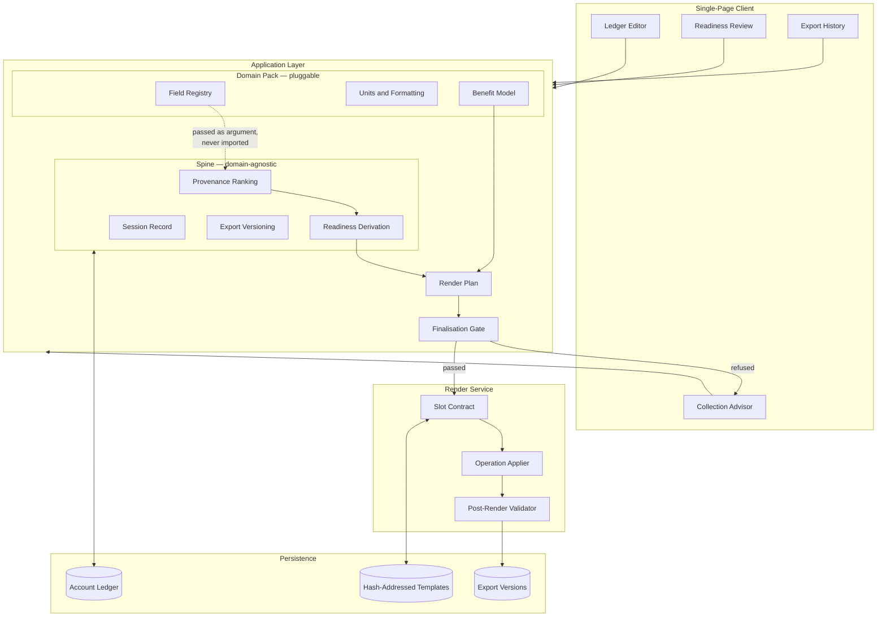
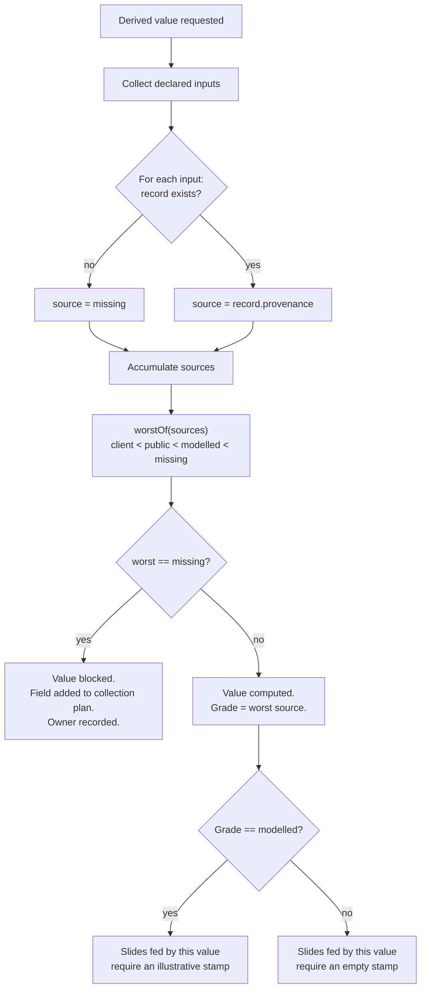
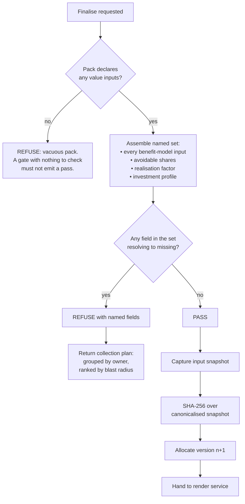
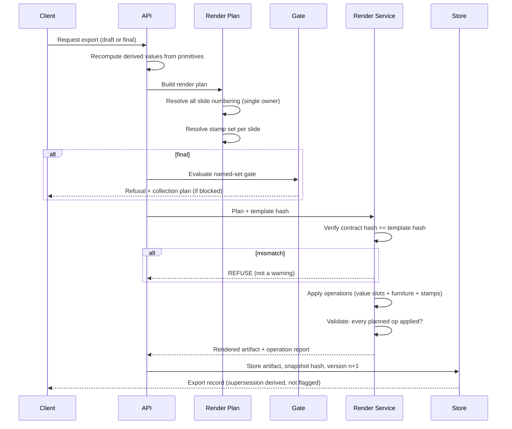
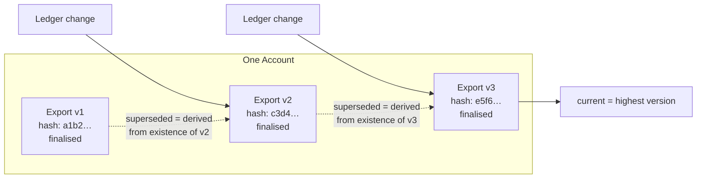
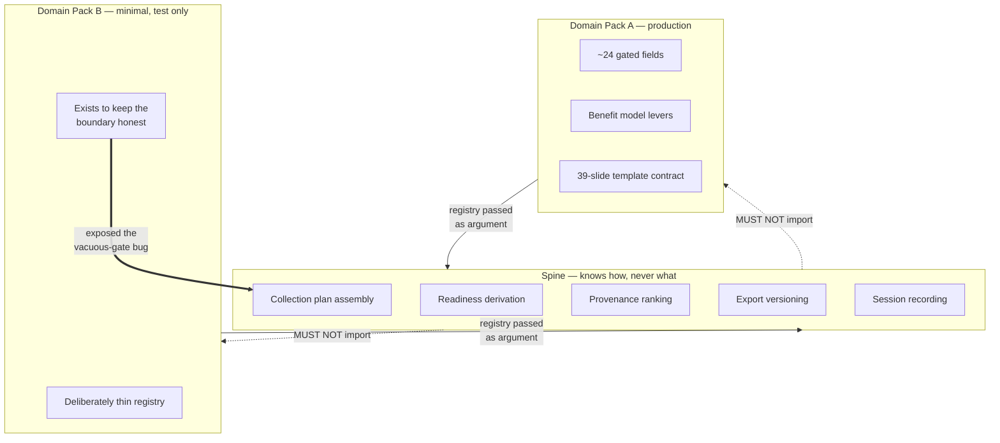
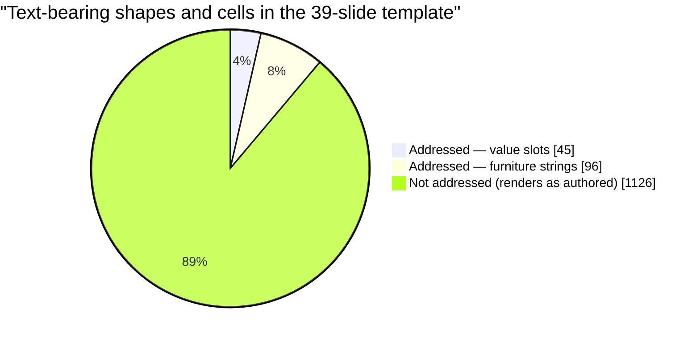

# Architecture Diagrams

Detailed diagrams for the provenance-gated document generation platform. All
diagrams describe design and control flow; none describe implementation
internals.

---

## 1. High-Level System Architecture

---

## 2. Provenance Resolution — Weakest Link

How a derived value acquires its provenance grade. The rule is mechanical: the
derived value is never better-evidenced than its worst input.

> **Design note.** The `missing` branch is a first-class source value, not the
> absence of a record. While absence was represented as undefined, new fields
> were simultaneously invisible to the gap list, the collection plan, the advisor
> and the stamping logic — four bugs with one cause.

---

## 3. The Finalisation Gate

The gate refuses on a named set of fields and returns the collection plan as its
refusal payload, so the answer to *why was this refused* and the answer to *what
do I do next* are the same object.

---

## 4. Render Lifecycle

---

## 5. Export Versioning and Supersession

> A finalised export is never regenerated in place. `superseded` is derived from
> the version sequence rather than written onto the older record, because a flag
> that must be set is a flag that will be missed.

---

## 6. Spine and Pack Boundary

---

## 7. Slot Contract Coverage

Scale of the render target, and the deliberate limits of what the contract
addresses.

| Measure | Count |
|---|---|
| Slides in template | 39 |
| Slides carrying any generated value | 16 |
| Text-bearing shapes and cells | 1,267 |
| Contract-addressed entries | 141 |
| — value slots | 45 |
| — furniture strings | 96 |
| Fields in the finalisation gate | 24 |

> The 1,126 unaddressed shapes are the reason the template is described as
> domain-shaped rather than branded. Much of that text carries industry-specific
> vocabulary, so a different industry needs a different pack and template, not
> more holes in this one.
