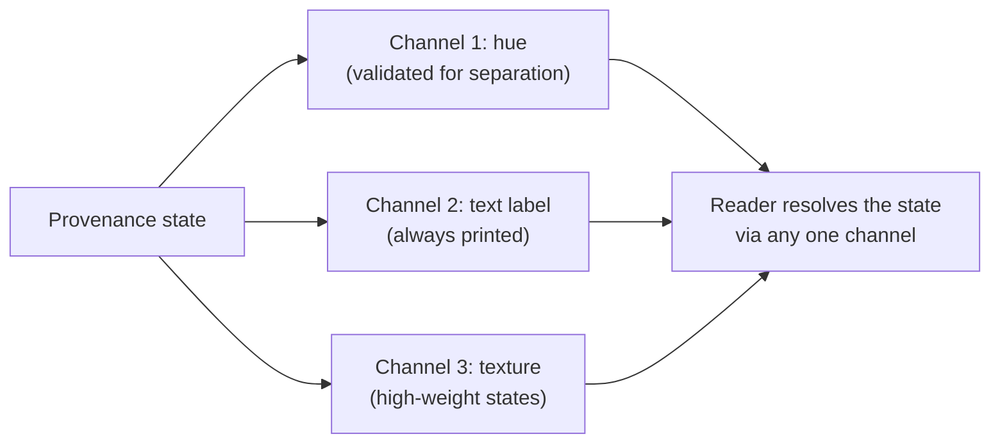

# Accessibility Validation Pattern

When colour distinguishes four states that change what a reader believes, colour
is data. It gets validated like data.

---

## The Requirement

Four provenance states are displayed as coloured chips. A reader who cannot
distinguish two of them cannot distinguish a customer-confirmed figure from a
modelled one — which is the single distinction the entire system exists to make.

So the palette is not a style choice. It is a correctness requirement with a
test.

---

## The Validator

Each candidate palette is checked against four criteria:

| Criterion | What it checks |
|---|---|
| **Lightness band** | Every chip sits within a usable lightness range for its surface |
| **Chroma floor** | Each colour carries enough saturation to read as a distinct hue, not a grey |
| **Normal-vision separation** | Minimum perceptual distance between every pair, for unimpaired vision |
| **Contrast** | Chip against surface, and label text against chip |

Pairs are then re-tested under simulated colour vision deficiency —
deuteranopia, protanopia and tritanopia — using the same minimum separation
threshold.

```
validatePalette(palette, surface):
    failures = []
    for c in palette:
        if not inLightnessBand(c, surface): failures.append((c, "lightness"))
        if chroma(c) < CHROMA_FLOOR:        failures.append((c, "chroma"))
        if contrast(c, surface) < MIN:      failures.append((c, "contrast"))
    for (a, b) in pairs(palette):
        if deltaE(a, b) < MIN_SEPARATION:
            failures.append(((a,b), "normal vision"))
        for sim in [DEUTAN, PROTAN, TRITAN]:
            if deltaE(sim(a), sim(b)) < MIN_SEPARATION:
                failures.append(((a,b), sim.name))
    return failures
```

---

## The Dark Theme Is Not the Light Theme Dimmed

The light palette was run against the dark surface to see what would happen. It
failed on four counts simultaneously:

- lightness band
- chroma floor
- normal-vision separation floor
- contrast

And the decisive one: the same-lightness green and red — the `client` and
`missing` states, the two that matter most — sat **within ΔE 1 of each other
under deuteranope simulation**. Which is to say, identical. On the dark theme, a
deuteranopic reader could not tell a confirmed figure from a missing one.

The dark set was re-derived from scratch against the same validator rather than
adjusted by eye.

**Cost:** two palettes to maintain. **Mitigation:** both are validated in CI, so
a palette change that breaks separation fails the build rather than shipping.

---

## Colour Is Never the Only Channel

Two redundant carriers are always present:

1. **Every chip prints its own text label.** A reader who cannot resolve the
   hue reads the word.
2. **The two highest-weight states carry a texture fill.** A reader scanning for
   pattern rather than reading labels still gets the distinction.



---

## Why This Belongs in a Case Study

Accessibility work is usually documented as compliance. Here it is documented as
a **defect class**, because that is what it was: a palette that renders two
opposite meanings as the same colour for part of the audience is a correctness
bug in the provenance system, not a styling shortfall.

Framing it that way is what got it a validator and a CI check rather than a
ticket in the backlog.
