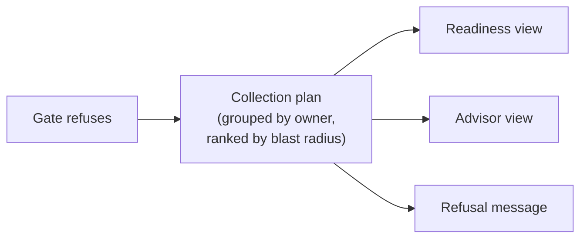

# Readiness Gate Pattern

The gate decides whether a deliverable may be finalised. It refuses on a named
set of fields and returns the worklist as its refusal payload.

---

## Why Not a Completeness Score

The obvious design is a threshold: finalise at 80% evidenced. It was rejected on
three grounds.

| Problem | Consequence |
|---|---|
| **Gameable** | Adding ten trivial fields raises the percentage without improving the deliverable |
| **Uninformative** | *"82% evidenced"* does not say which 18%, or whether it matters |
| **Negotiable** | A number invites *"is 82% good enough?"*, a question nobody can answer without the list the number replaced |

A named set has none of these properties. It cannot be diluted, it says exactly
what is absent, and there is nothing to negotiate.

---

## The Named Set

The gate set is assembled from the domain pack, not hand-maintained:

```
gateSet(registry):
    s = set()
    for lever in registry.benefitModel.levers:
        s |= lever.declaredInputs          # every input the model reads
    s |= registry.avoidableShares
    s |= { registry.realisationFactor }
    s |= registry.investmentProfile
    return s
```

Deriving the set from the model means a new lever automatically extends the
gate. A hand-maintained list drifts the first time someone adds a lever in a
hurry.

---

## Evaluation

```
evaluate(ledger, registry):
    # 1. A gate with nothing to check must not emit a pass.
    if registry.benefitModel.declaredInputs is empty:
        return REFUSED(reason: VACUOUS_PACK)

    s = gateSet(registry)
    absent = [ k for k in s if resolve(k, ledger, registry).provenance == MISSING ]

    if absent is not empty:
        return REFUSED(
            reason: MISSING_EVIDENCE,
            fields: absent,
            worklist: collectionPlan(ledger, registry, gateSet: s),
        )

    return PASSED
```

---

## The Vacuous Check

A domain pack declaring no value inputs is refused as **vacuous** rather than
passed.

Without that rule the minimal test pack sailed straight through: it had nothing
to check, so nothing failed, and the gate emitted a pass — and a pass produces a
finalisation record, an immutable export and a version number. A gate that
succeeds because it was handed no work is strictly worse than no gate, because
it manufactures evidence of review.

This bug was structurally invisible to the production pack, which always has
inputs. It was caught only because a second, deliberately minimal pack existed.
That is the argument for writing the second implementation early rather than
when the second real case arrives.

---

## Refusal Is the Worklist

The refusal payload is the collection plan object — the same structure the
advisor renders, grouped by owner and ranked by blast radius.



One object, three surfaces. *Why was this refused* and *what do I do about it*
resolve to the same answer, so the engineer never navigates from the error to a
different screen to act on it.

---

## Draft vs Final

The gate applies to finalisation only. Drafts render at any readiness, because
a draft is a working artifact and blocking it would push people back into
hand-authoring — which is the behaviour the whole system exists to remove.

| | Draft | Final |
|---|---|---|
| Gate evaluated | no | yes |
| Stamps applied | yes | yes |
| Versioned | no | yes |
| Immutable | no | yes |
| Input snapshot hashed | no | yes |

Stamps apply to drafts precisely because drafts leak. A draft that escapes
without its illustrative markings causes the exact failure the system was built
to prevent.
