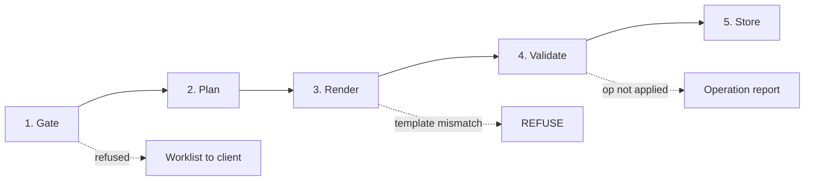

# Render Pipeline Pattern

Five stages, in order, with one owner for slide numbering and a refusal where
the failure mode is silent.



---

## 1. Gate

Finalisation only. See [readiness-gate.md](readiness-gate.md).

## 2. Plan

The plan recomputes every derived value from ledger primitives, resolves the
stamp set, and — critically — **owns all slide numbering**.

```
buildPlan(ledger, registry, contract):
    values     = recomputeAll(ledger, registry)   # never read from storage
    duplicated = resolveDuplications(values, contract)
    numbering  = assignSlideNumbers(contract.slides, duplicated)
    stamps     = stampsFor(numbering, registry, ledger)
    ops        = []
    for slot in contract.slots:
        ops.append({ slide: numbering[slot.slide], shape: slot.shape,
                     index: slot.cellIndex, text: format(values, slot) })
    for slide, text in stamps:
        ops.append({ slide, shape: contract.stampShape(slide), text })
    return { ops, numbering, expectedOpCount: len(ops) }
```

### Numbering lives in exactly one module

Slide duplication combined with slide addressing was got wrong in both
directions during development:

| Mistake | Symptom | Severity |
|---|---|---|
| Duplicate **after** addressing | 14 operations failed with unresolved targets | Recoverable — loud |
| Duplicate **before** addressing, without remapping | One slide's content written onto another | **Silent and wrong** |

The renderer now performs no index arithmetic whatsoever. It receives absolute
slide numbers and applies them. The entire class of defect was removed by moving
the arithmetic, not by testing it harder.

## 3. Render

```
render(plan, template, contract):
    if sha256(template) != contract.templateHash:
        refuse("contract bound to a different template")   # not a warning
    deck = open(template)
    applied, failed = [], []
    for op in plan.ops:
        target = locate(deck, op.slide, op.shape, op.index)
        if target is null: failed.append(op); continue
        write(target, op.text); applied.append(op)
    return deck, applied, failed
```

See [slot-contract.md](slot-contract.md) for why the hash check is a refusal.

## 4. Validate

```
validate(plan, applied, failed):
    if len(applied) != plan.expectedOpCount or failed is not empty:
        return REPORT(applied: len(applied), failed: failed)
    return CLEAN
```

The validator compares against the **planned** operation count, not against
whatever the renderer attempted. A renderer that silently drops an operation
before attempting it is exactly the case this catches.

## 5. Store

```
store(artifact, snapshot, account):
    version = highestVersion(account) + 1
    return persist({
        artifact,
        version,
        snapshotHash:    sha256(canonicalise(snapshot)),
        rendererVersion: RENDERER_VERSION,
        finalisedAt:     now(),
    })
    # `superseded` is NOT written — it is derived from the existence of
    # a higher version at read time.
```

### Hash the input, not the bytes

Office formats are zip archives with embedded timestamps, so two renders of
identical content produce different bytes. Byte hashing reports a change on
every render, and a change detector that always fires is not one.

Hashing the canonicalised input snapshot means identical inputs hash
identically. Renderer version is recorded separately, so an output difference
caused by a renderer upgrade is still detectable without poisoning the content
fingerprint.

### Immutability

A finalised export is never regenerated. A later ledger change produces version
*n+1*. Supersession is derived at read time from the version sequence, because a
flag that must be set is a flag that will eventually be missed.
