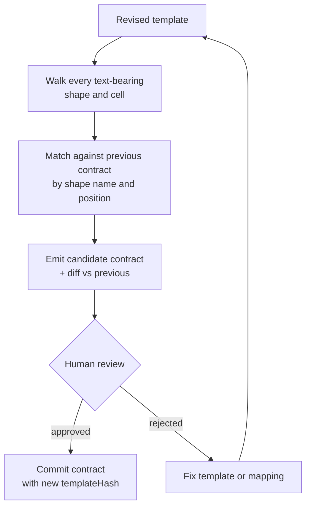

# Slot Contract Pattern

A contract that binds generated values to specific locations in a specific
template, addressed by a hash rather than a filename.

---

## What the Contract Is

```
SlotContract
  templateHash   sha256 of the template file the contract was derived from
  slots[]        value slots — where a generated figure is written
  furniture[]    static strings the render owns (headings, labels, legends)
  stampShapes{}  slideNumber -> shape identifier for the provenance stamp
```

| Measure | Count |
|---|---|
| Slides in template | 39 |
| Slides carrying any generated value | 16 |
| Text-bearing shapes and cells in file | 1,267 |
| Contract-addressed entries | 141 |
| — value slots | 45 |
| — furniture strings | 96 |

The remaining 1,126 shapes render as authored. They are invisible to the
pipeline, which is both the reason the system is tractable and the reason the
template is domain-shaped rather than merely branded.

---

## Addressing

Shapes are addressed by slide number plus the authoring tool's auto-generated
shape name. Table cells are addressed by flat index within the table.

Both are **brittle by nature**:

- Auto-generated shape names are assigned at authoring time and are not stable
  across a re-save in some editors.
- Flat cell index shifts the moment a row or column is inserted.

This brittleness was accepted rather than engineered around. The alternatives —
semantic tagging in the template, or heuristic matching on nearby text — either
require authoring discipline the template owners will not maintain, or fail
silently in exactly the cases that matter. Brittle addressing plus a hard
integrity check is a better trade than forgiving addressing with no check.

---

## Why Mismatch Is a Refusal, Not a Warning

Rendering against a mismatched template was tested directly rather than
reasoned about. The result:

> **372 operations applied. 1 failed. Validation clean.**

One value silently lost. A file that opens correctly, looks finished, and is
wrong in a way no reviewer would catch — because the missing figure's slot
simply retained its template placeholder.

```
render(plan, template, contract):
    if sha256(template) != contract.templateHash:
        refuse("contract bound to a different template")
```

A warning is read once and then filtered. The governing test is not how bad the
outcome is, it is **whether anyone would notice**. Nobody would notice this one,
so it refuses.

---

## Contract Derivation

A template revision requires re-deriving the contract. Tooling walks the file
and emits a candidate contract; a human reviews the diff before it is
committed.



The derived output is never committed unreviewed. An auto-derived contract that
silently remaps a slot is the same failure class the hash check exists to
prevent, reintroduced one layer up.

---

## Portability — Stated Honestly

The contract is **not portable**. A second template means a second contract and,
realistically, a second domain pack: much of the unaddressed furniture carries
industry-specific vocabulary, so pointing this pack at another industry's
template produces correct numbers inside the wrong deck.

That outcome is worse than an obviously wrong deck, because it looks finished.
The chosen direction is therefore one template per domain pack rather than one
template with more holes in it.
